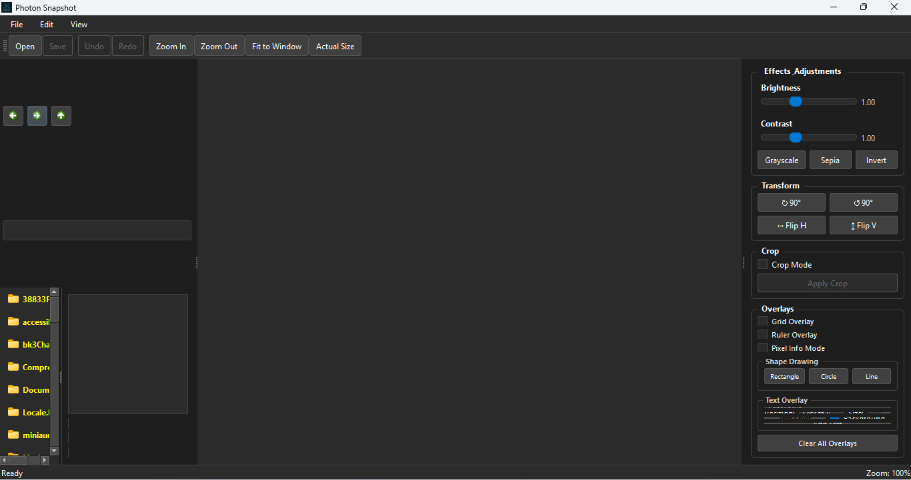

# Photon Snapshot

Image viewer/editor. Built with Python using PySide6 QT and Pillow.



## Features

* **Explorer panel** (dockable, hideable) with a pinned-folder Library, a
  file list, a path bar, and current-folder search - browse and open images
  directly without an Open File dialog.
* **Image editing**, grouped by category into a collapsible accordion:
  Adjustments (brightness/contrast), Transform (rotate/flip), Crop,
  Overlays (grid, ruler, pixel info, shapes, text), and Draw (freehand
  canvas drawing that paints directly onto the image's pixels).
* Full undo/redo history for every edit.
* **Responsive layout**: the Explorer dock and the editing-tools panel can
  each be shown/hidden, and the rest of the interface reclaims their space
  when they're hidden. The menubar, toolbar, and status bar are all
  independently toggleable from the View menu.
* **Keyboard navigation**: F6 / Shift+F6 cycle focus between the toolbar,
  Explorer, image canvas, and status bar, matching the pane-navigation
  behavior of [playForm](https://github.com/still-standing88/playform).
* **akeyconfig**: every action's keyboard shortcut is remappable from
  Options -> Hotkeys.
* **Multilingual UI**: English, Arabic (with RTL layout), French, and
  Spanish, switchable from Options -> Preferences.
* **Built-in updater**: checks the project's GitHub releases on startup
  (and on demand from Options -> Check for Updates) and offers to open the
  new release's download page.
* System tray icon with minimize-to-tray support, and a startup splash
  screen.
* All application data - preferences, recent/favorite files, pinned
  library folders, key bindings, and window layout - is stored in a single
  SQLite database under `~/.photon-snapshot/`.
* Accessible by design: every info-bearing label is keyboard-reachable
  (Tab), every interactive control has an accessible name, and numeric
  inputs use range-capped spin boxes rather than free-form text fields.

## Building

### Build Environment

Photon Snapshot requires Python 3.12 or higher. You'll also require UPX for
compressing the executable's size. Download UPX from
[here](https://github.com/upx/upx/releases/tag/v5.0.1).

Clone the repo

```bash
git clone https://github.com/still-standing88/photon-snapshot.git
cd photon-snapshot
```

Create a new environment, or install packages globally

```bash
python -m venv venv
```

Then on Windows

```bash
venv\scripts\activate
```

For Linux/Mac

```bash
source venv/bin/activate
```

Then install requirements

```bash
pip install -r requirements.txt
```

For development tasks (the `invoke`-based `tasks.py` - i18n pipeline,
running from source, etc.) also install:

```bash
pip install -r requirements-dev.txt
```

### Building

Before running the command, make sure UPX is on your path variable.

```bash
python build.py
```

For MSI package distribution

```powershell
powershell .\installer\windows\build-msi.ps1 -SourceDir dist\app.dist -OutputDir dist\ -Version 1.1.0
```

### Translations

The UI strings live in `lang/photon_snapshot.pot` (extracted from every
`_("...")` call in `src/`) and the per-language `.po` files under
`lang/<code>/LC_MESSAGES/`. To regenerate everything after changing source
strings or translations:

```bash
invoke i18n
```

or run the three steps individually: `scripts/extract_strings.py`,
`scripts/build_po.py` (reads `scripts/translations_data.py`), then
`scripts/compile_lang.py` (produces the `.mo` catalogs the app loads).

## License

[MIT](./LICENSE)
